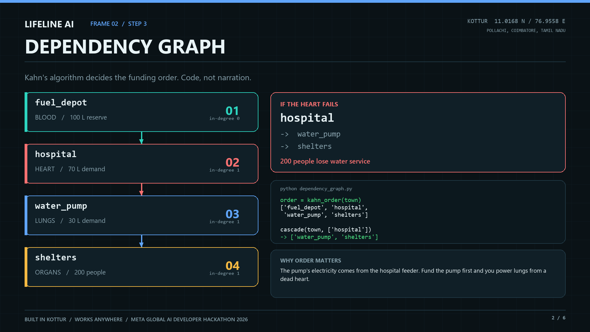
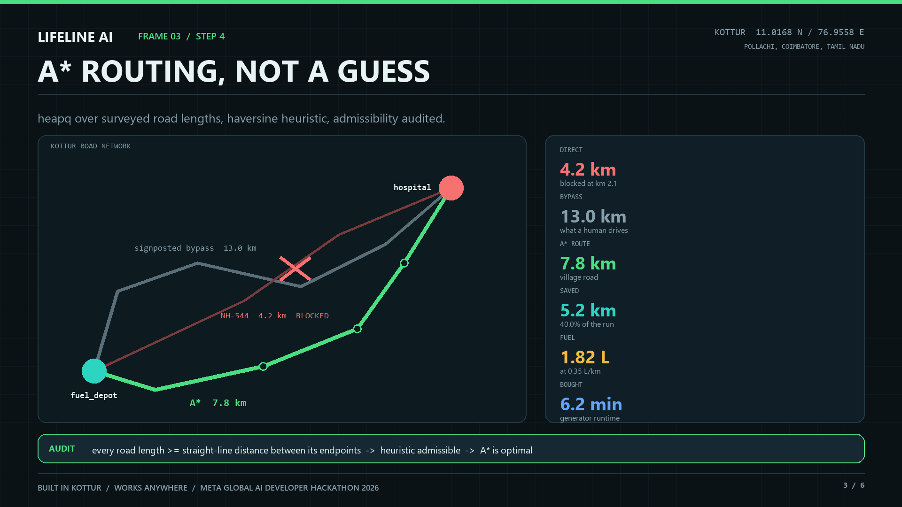
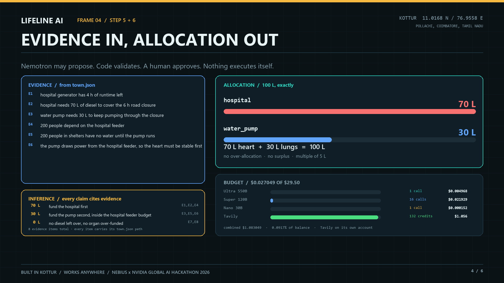
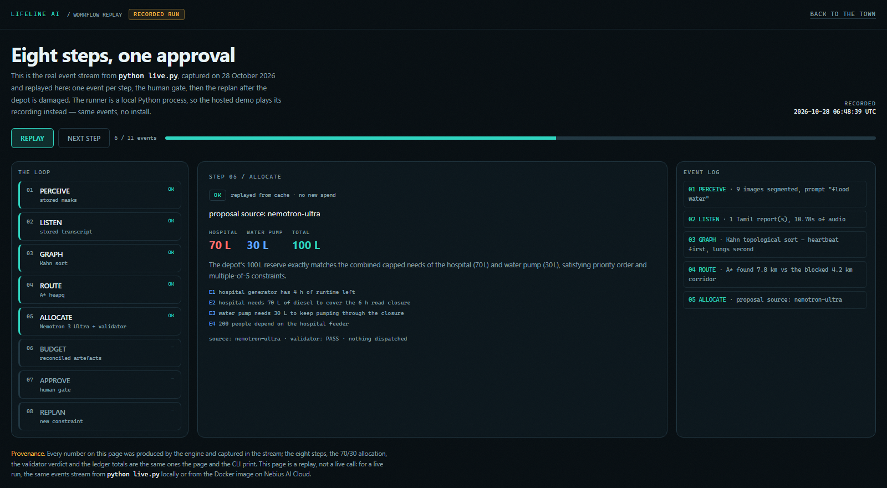
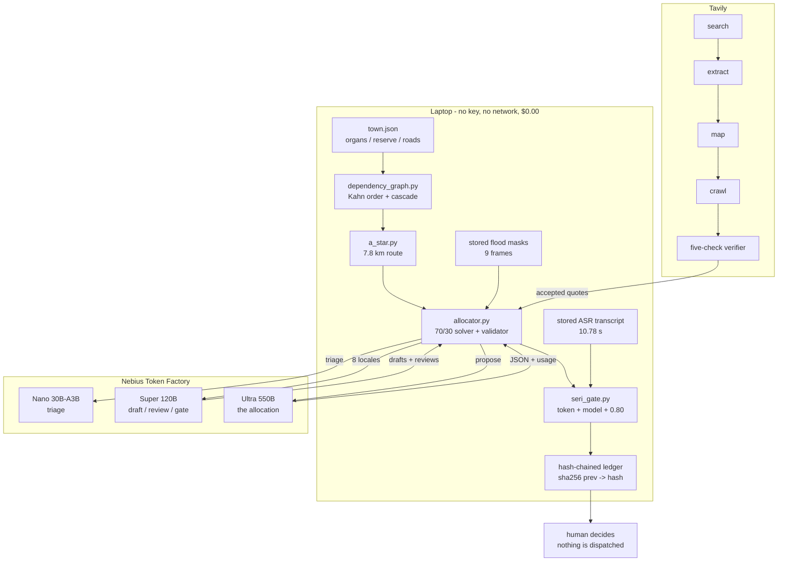

<div align="center">
  
</div>

# LIFELINE AI

### When the road dies, the town still has to decide.

**A disaster-response agent that allocates the last 100 litres of diesel, routes around a landslide, and
holds the decision at a human gate — reasoned by NVIDIA Nemotron 3 on Nebius Token Factory, with every
outside fact retrieved and checked through Tavily.**

<p>
  <a href="https://lifeline-ai-nebius.vercel.app"></a>
  
  
  
  
  
  
</p>

Solo entry · **Nebius × NVIDIA Global AI Hackathon 2026** · **Best Apps and Agents**
· **Best Use of Tavily** · [@abinivesh-m](https://github.com/abinivesh-m)

**Demo:** <https://lifeline-ai-nebius.vercel.app> · **Workflow replay:**
<https://lifeline-ai-nebius.vercel.app/live/> — the eight-step event stream, recorded from a real run.

> **The town is real. The scenario is simulated.** Kottur, Pollachi Taluk, Coimbatore, Tamil Nadu —
> 11.0168 N, 76.9558 E — sits at the foot of the Western Ghats, where the **Pollachi–Valparai ghat road**
> closes under boulders every monsoon. The most recent real closure was **22 October 2026: reopened after
> 15 hours**
> ([New Indian Express](https://www.newindianexpress.com/states/tamil-nadu/2026/Oct/22/tamil-nadu-pollachi-valparai-ghat-road-reopens-after-15-hours-following-landslide)).
> The 6-hour closure, the 100 L reserve and the 70/30 split are **town data**, not a claim that a specific
> landslide happened on a specific date. [What is real](#what-is-real-and-what-is-simulated) draws that
> line precisely.

**What makes this different.** Most agents call a model and trust the answer. This one (1) derives the
allocation from constraints and rejects bad proposals in code, (2) treats every web fact as a quoted,
five-checked claim with a published rejection log, and (3) runs the whole plan with the network off, then
seals the human decision in a hash chain. The model is the fast path, not the only path.

---

## At a glance

| | |
| --- | --- |
| **What it is** | an agent that orders a town's survival dependencies, routes around a closure, and rations fuel |
| **Models** | Nemotron 3 Nano 30B-A3B · Super 120B · Ultra 550B, all on Nebius Token Factory |
| **Evidence** | Tavily search + extract + map + crawl, then a five-check verifier that rejects as often as it accepts |
| **Determinism** | 6 of 8 steps make no model call — four compute, two replay stored artefacts; the 70/30 result ships even when every API is down |
| **Measured spend** | **$0.027049** inference across 18 calls · **$1.056** Tavily across 132 credits · **$1.083049** combined |
| **Tests** | **78 passed**, standard library only, no network |
| **License** | MIT |

---

## The Tavily case, on one screen

The town's own numbers are data. Everything **outside** the town — what a landslide does to a highway,
what a hospital generator actually burns, whether a closure is real — comes from the web, and a judge must
be able to check it without trusting us.

Four endpoint types do real work at `advanced` depth: **search** (ranked results + answer + raw content +
image descriptions), **extract** (the pages actually opened), **map** (the site structure of the authority
being cited), and **crawl** (map + extract in one hop, to prove a source was explored, not stumbled on).

**47 calls · 132 credits · 10 queries · 37 pages fetched · 17 claims checked · 9 accepted · 8 rejected.**
Every row is in [`artifacts/tavily_proof.json`](artifacts/tavily_proof.json) with its quote, URL, score,
date and verdict.

A claim is accepted only when **five independent checks** pass:

| # | Check | What it kills |
| --- | --- | --- |
| 1 | **Literal quote** — sliced out of the fetched body | paraphrased "evidence" |
| 2 | **Fetched, not found** — URL in the extract success list | search hits passed off as sources |
| 3 | **Dated** — inside the mode window | a 2023 figure quoted as current |
| 4 | **Relevant** — Tavily's own score ≥ **0.20** | the confident, irrelevant hit |
| 5 | **Regional** — region terms match | a landslide on another continent |

Three real rows, including the two ways it says no:

| Source | Score | Verdict |
| --- | --- | --- |
| [Times of India, 21 Oct 2026](https://timesofindia.indiatimes.com/city/chennai/heavy-rains-trigger-landslide-on-valparai-ghat-road/articleshow/135099368.cms) | **0.932** | **accepted** |
| [New Indian Express, 26 Oct 2026](https://www.newindianexpress.com/states/odisha/2026/Oct/26/iit-delhi-team-inspects-landslide-hit-kalinga-ghat) | **0.872** | **rejected** — no regional anchor |
| [BBC, 27 Jan 2024](https://www.bbc.com/news/uk-england-surrey-68082814) † | **0.014** | **rejected** — below the 0.20 floor |

The second row is the one that matters: a high-scoring, freshly dated story from a serious paper, thrown
out because it is the wrong region. The third is the failure that created check 4 — a BBC story about an
**M25 footbridge** accepted as support for "landslide closes road", purely because both sentences contained
the word *closed*. † Kept under `modes.scenario.rejected_examples`, outside the 17-claim totals.

A verifier that accepts everything would cost $0.00 and be worth nothing. This one costs $1.06 and
rejects 8 of 17 claims.

---

## The problem

The problem is ordering, not supply. A hospital generator with four hours left and a water pump on the
same feeder compete for 100 litres. Both draw from the one generator tank, so the pump's 30 L is a budget
line, not a second tank. Split 50/50 and the feeder browns out; give the hospital 70 and the same pump runs
three times longer on its 30. Same diesel, same town, three times the water.

The hard part is not the arithmetic. It is that the arithmetic depends on facts the town does not own:
whether the road is open, what a landslide does to a supply chain, how much fuel a hospital generator
actually burns. Those facts arrive from the web, and a wrong one is worse than no answer.

Lifeline separates the two. **The town's own numbers are data. Everything outside the town is evidence,
fetched and quoted.** The model proposes; code disposes.

## What it does

```text
100 L diesel  ->  hospital 70 L + water pump 30 L        exactly 100, no waste
route         ->  7.8 km village road vs the 13.0 km signposted bypass   (-40% trip fuel)
pump uptime   ->  30 min -> 90 min           water back in 2 h instead of 6 h
decision      ->  held at a human gate, never auto-executed
```

Eight steps. Six make no model call — four compute, two replay stored artefacts. One is a model proposal
checked in code; the last is classified by a model, then held for a human.

## Screens

| Dependency order | Route | Allocation |
| --- | --- | --- |
|  |  |  |
| Kahn order puts the heart before the lungs | 4.2 km blocked, 7.8 km found | the model's proposal, checked field by field |

[](https://lifeline-ai-nebius.vercel.app/live/)

The replay at **[/live/](https://lifeline-ai-nebius.vercel.app/live/)** plays the recorded event stream:
press play, or click any step in the rail. The frame above is step 05, the allocation, with the validator
verdict and the four evidence rows the model cited.

## The eight steps

| # | Step | Who does it | Needs a model? |
| --- | --- | --- | --- |
| 1 | Perceive flood extent | stored segmentation masks, replayed from `artifacts/` | no — stored artefact |
| 2 | Listen to field reports | stored transcript, replayed verbatim | no — stored artefact |
| 3 | Graph the town, sort dependencies | `dependency_graph.py` (Kahn) | **no** |
| 4 | Route around the landslide | `a_star.py` (heapq + haversine) | **no** |
| 5 | Allocate 100 L with evidence vs inference | `allocator.py` → Nemotron 3 Ultra | proposes; code validates |
| 6 | Budget the spend | `credit_tracker.py` + artefact reconciliation | **no** |
| 7 | Approve, escalate, speak | `escalation.py` + `seri_gate.py` | one human word |
| 8 | Replan when the world changes | `agent.py` | **no** |

Play the same eight steps back at <https://lifeline-ai-nebius.vercel.app/live/> — one event per step, held
at the human gate, then the replan after the depot is damaged.

## Architecture



`brain.py` is the only file that knows a provider exists. The engine exports no model name, so the
deterministic path is identical whether the cloud answers or not. The Tavily path is the only way an
outside fact reaches the allocator, and it reaches it only as a quote that passed all five checks.

## Why this is an agent, not a wrapper

1. **The model proposes, code disposes.** Ultra returns `{"allocation": ..., "justification": ...}`. Every
   field goes through the same validator the deterministic solver uses. Over-allocation, a short total, or
   starving the heart while funding the lungs is rejected with a reason, and the policy solver takes over.
   The 70/30 result ships either way.
2. **Evidence and inference are different objects.** Each `evidence[]` item carries the exact `town.json`
   path it came from; each `inference[]` item cites evidence ids (`because: ["E1","E2"]`). A test resolves
   every path and every cited id, so an invented justification fails CI.
3. **Web facts are quoted, not summarised.** See [the five checks](#the-tavily-case-on-one-screen).

## Nemotron 3 on Token Factory

Three tiers, resolved from the live `GET /v1/models` catalogue rather than typed from memory, with prices
read from the same response:

| Tier | Model ID | $/M in → out | Used for |
| --- | --- | --- | --- |
| fast | `nvidia/NVIDIA-Nemotron-3-Nano-30B-A3B` | 0.06 → 0.24 | one measured triage call; too slow for long drafts |
| deep | `nvidia/nemotron-3-super-120b-a12b` | 0.30 → 0.90 | 8-language drafting **and** review of every locale |
| decision | `nvidia/Nemotron-3-Ultra-550b-a55b` | 1.00 → 3.00 | the one allocation that matters |

**The tier choice is measured, not assumed.** The same 8-language draft prompt, three ways:

| Model | Token cap | Result | Completion tokens | Wall |
| --- | --- | --- | --- | --- |
| Nano 30B-A3B | 6,000 | `finish_reason=length`, **empty content** | 6,000 (all reasoning) | 59 s |
| Nano 30B-A3B | 16,000 | answered | 3,449 | 38 s |
| Super 120b | 6,000 | answered | 966 | **6.7 s** |

Super is 5.6× faster and uses a third of the tokens for this task, so drafting runs on Super.
`reasoning_effort=low` does not bound Nano's thinking — that is a finding, not a workaround.

The proof run measured Ultra at **3.37 s** for the allocation call (the first probe answered in 1.98 s),
valid JSON, `{"hospital": 70, "water_pump": 30}`, validator **PASS**. The proof artefact holds all three
tiers: **4,834 tokens, $0.00595068, 15.33 s wall**. Reproduce with `python scripts/nebius_proof.py`.

The tiering is the point of the entry: Nano and Super absorb the volume so that Ultra is affordable for
the single decision where reasoning changes the outcome.

## Two modes, never blended

| Mode | Question | Window |
| --- | --- | --- |
| **Scenario** | what did comparable 2023 events do to roads, grids and fuel? | 2023-11-01 → 2024-02-29 |
| **Live** | what is true on this road **today**? | last 45 days |

Blending them is how a 2023 figure gets quoted as current. The UI labels the mode on every row and the
artefact stores the window with the claim.

Every response is cached by request hash, so the proof artefact rebuilds offline and re-running costs zero
credits:

```bash
python evidence.py --mode live                # real calls
python evidence.py --mode live --replay       # cache only, no network
```

Credits are read from the API's own `usage` field and appended to `artifacts/tavily_usage.json` — never
computed from a price table we wrote ourselves.

## Eight languages, one gate

The same alert is drafted in **English, Spanish, French, Chinese, Arabic, Portuguese, Swahili and Tamil**
by Nemotron 3 Super, then reviewed by Super, then checked in code for length, forbidden numbers, medical
advice, links and reply codes. The validator is the last word: a reviewer model cannot approve a payload
that contains an invented figure.

| Measure | Result |
| --- | --- |
| Locales with all three payloads valid | **8 / 8** |
| Model-drafted (not template fallback) | **8 / 8** |
| Drafting + review | **8 Super calls, $0.020234** |
| Spoken locales | **7** — Mandarin has no released MMS-TTS checkpoint, so it ships text-only |
| Voice gate | **7 / 7 approved, 0 withheld**, 7 Super calls, **$0.000864** |

The gate is not a button. A stored transcript is replayed, classified by Nemotron 3 Super, and decided in
code: a question, a cough or a maybe is a no. A misheard "no" must never dispatch fuel. The seven
approvals are sealed in a hash-chained ledger (`artifacts/escalation_ledger.json`).

TTS is explicitly **not** an NVIDIA model and **not** a Nebius endpoint. It runs locally on CPU, costs
nothing, and is labelled synthetic on screen.

## What it costs

Every figure is measured in this repo. Unit prices are the catalogue rates; token and credit counts are
the ones the APIs returned.

| What | Calls | Cost | Share |
| --- | --- | --- | --- |
| Nemotron 3 Ultra — the allocation | 1 | **$0.004968** | 0.46% |
| Nemotron 3 Super — draft, review, gate | 16 | **$0.021929** | 2.02% |
| Nemotron 3 Nano — one triage call | 1 | **$0.000152** | 0.01% |
| **Nebius inference total** | **18** | **$0.027049** | **2.50%** |
| Tavily — search, extract, map, crawl | 47 | **$1.056000** | 97.50% |
| **Combined cash-equivalent** | **65** | **$1.083049** | **100%** |

At build time the Token Factory balance was **$29.50**, so inference used **0.0917%** of it; the remaining
**$29.472951** is untouched. Tavily's 132 credits sit on Tavily's own account at its list rate of $0.008 —
the combined figure is the honest cost of goods, not a claim that one provider bills the other.

The deterministic core is **$0.00 by construction**: Kahn ordering, A*, the solver, the validator, the
ledger, the gate and the replan make no network call. There is no model where arithmetic is sufficient.

## What is real, and what is simulated

| Item | Status |
| --- | --- |
| Kottur, its coordinates, the ghat road and its monsoon closures | **real** |
| Pollachi–Valparai closure, 22 Oct 2026, reopened after 15 h | **real**, linked above |
| `town.json` — 100 L reserve, 4 h generator, 70 L / 30 L demands, 6 h closure | **simulated**, chosen to be plausible |
| Flood masks, 9 frames, worst 59.4% | **stored pre-migration artefacts**, replayed and re-checked; no image model is called or billed |
| ASR transcript, 10.78 s | **stored pre-migration transcript**, replayed verbatim; no ASR call is claimed or billed |
| Nemotron 3 calls | **real**, 18 calls, $0.027049, traces in `artifacts/` |
| Tavily sources, quotes, scores, credits | **real**, per-row in `artifacts/tavily_proof.json` |
| TTS clips | **MMS-TTS, local CPU** — explicitly *not* NVIDIA, labelled synthetic |
| SMS / WhatsApp / voice delivery | **`PENDING_CREDENTIALS`** — payloads generated and logged in 8 locales, none transmitted (no gateway configured) |
| Demo deployment | **static demo live** at <https://lifeline-ai-nebius.vercel.app>, verified 200 anonymously on 28 Oct 2026. `/api/allocate` runs only in the included container, not on Vercel |

The stored-mask and stored-transcript rows are the ones a judge would otherwise catch. They are stated
before they are asked.

## Run it

Core is **standard library only** — no NumPy, no SDK, Python 3.11+ (measured on 3.14).

```bash
git clone https://github.com/abinivesh-m/lifeline-ai-nebius
cd lifeline-ai-nebius

python -m pytest -q                      # 78 tests, no network
python agent.py --yes --mode policy      # the eight steps, offline-safe
```

The agent runs with **no key at all** in policy mode. Keys add live calls:

```bash
cp .env.example .env                     # NEBIUS_API_KEY, TAVILY_API_KEY
python evidence.py --mode live           # Tavily: search + extract + map + crawl
python scripts/nebius_proof.py           # three real Nemotron calls, priced and timed
python allocator.py --mode auto          # live proposal, then the validator
python multilingual.py                   # 8 locales, drafted and reviewed on Super
```

`.env` is git-ignored. No key appears in this repository, its history, or its artefacts.

## Tests

```bash
python -m pytest -q
# 78 passed
```

The suite covers the route audit, the 70/30 constraint, the validator's rejection paths, the evidence
provenance, the five-check verifier, the hash chain, the 8-locale rules, the budget reconciliation and the
offline path. It makes no network call and needs no key.

## Feedback

Written from the build, not from the marketing page — see [`FEEDBACK.md`](FEEDBACK.md). It covers the
approval/credit gap, the near-duplicate model IDs, the missing `usage.cost_usd`, the absent TTFT trace, the
Docker assumption in the deploy path, and the two Tavily fields that would have saved code.

**Deep dive:** [architecture, the end-to-end call, configuration, deployment and the deterministic
proofs](docs/TECHNICAL.md).

---

**License.** MIT — see [`LICENSE`](LICENSE). **Contact.** abinivesh.1203@gmail.com — Kottur, Tamil Nadu, India.
