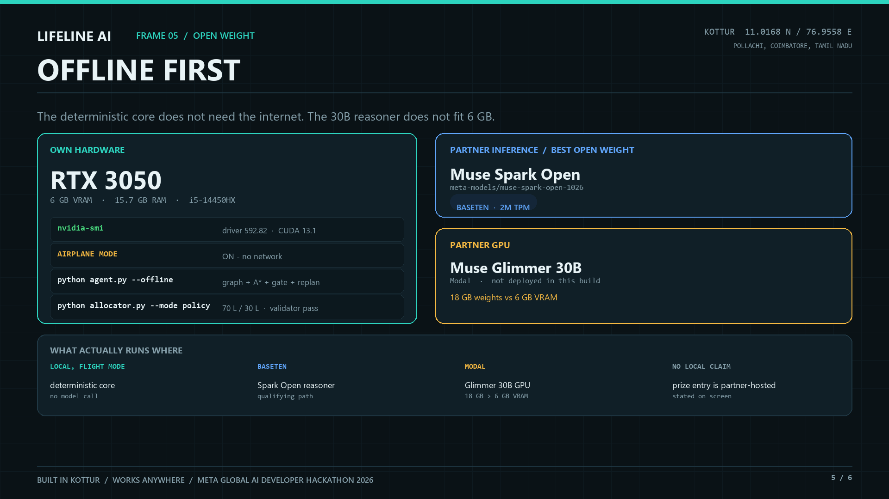
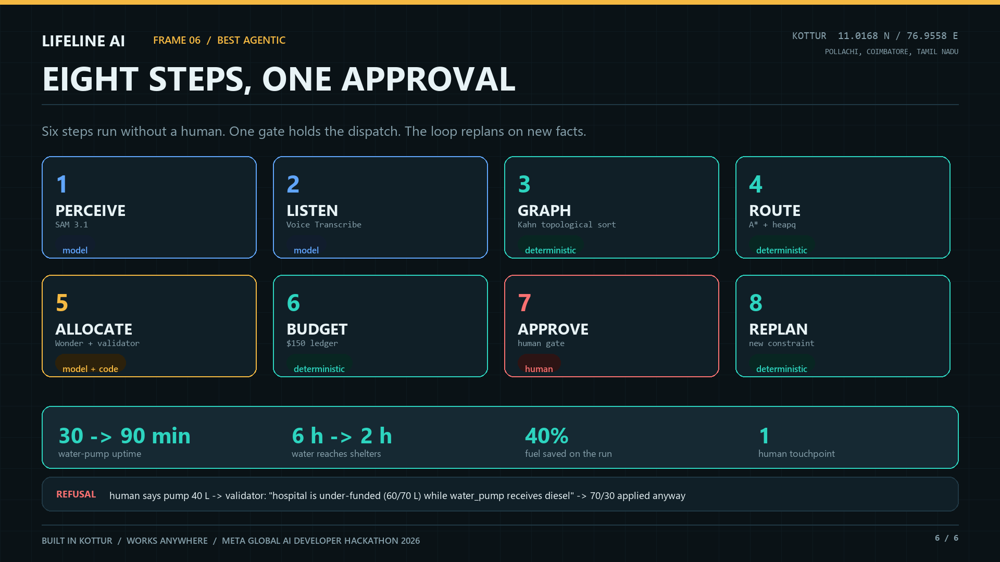
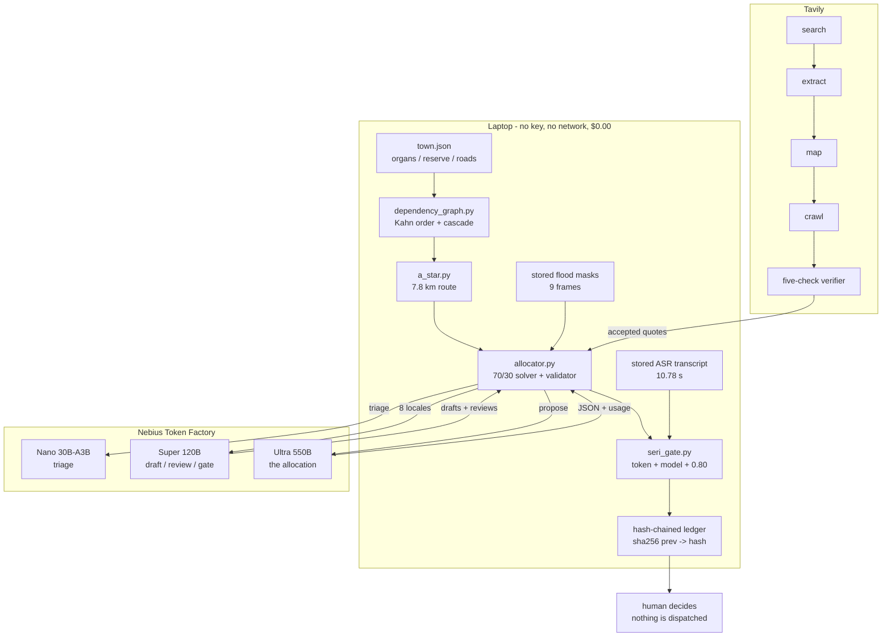
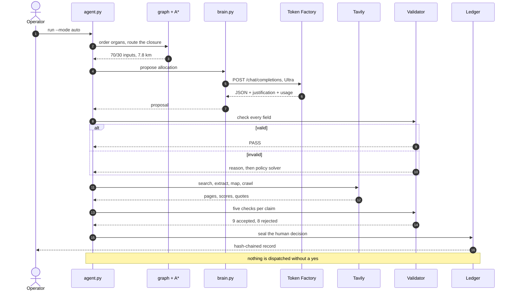
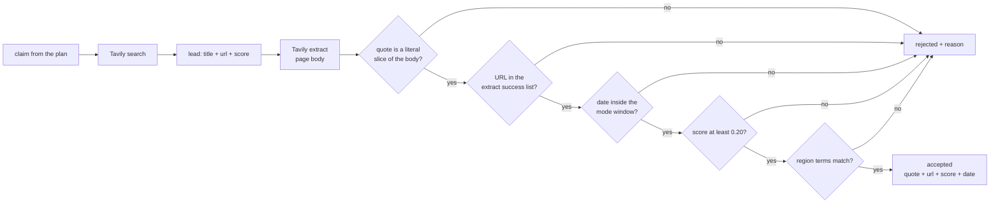
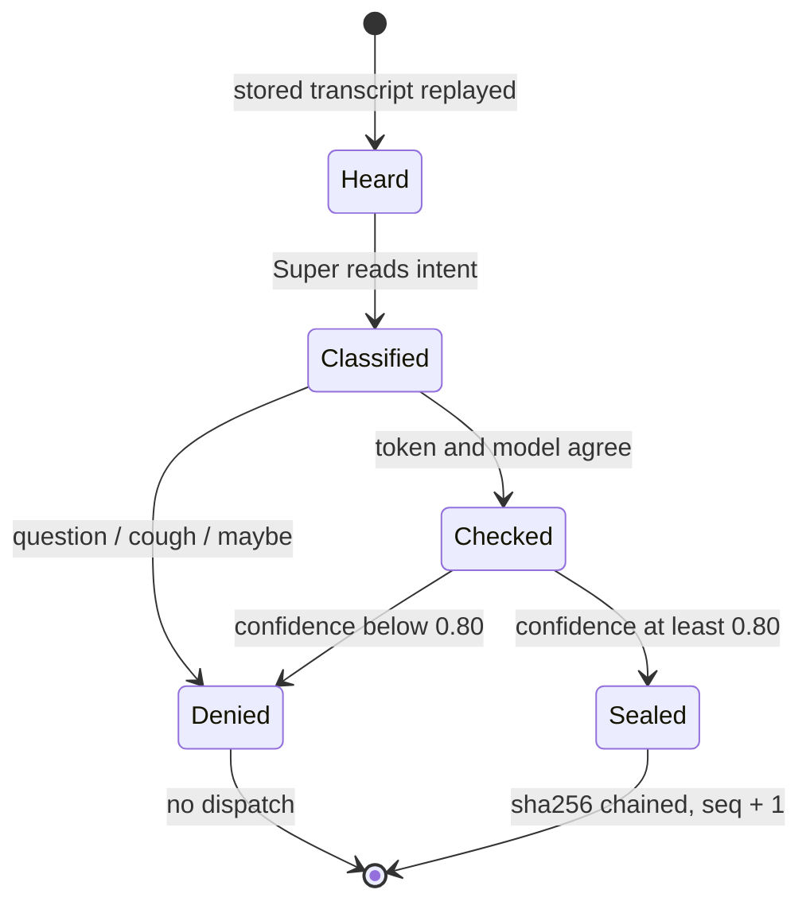
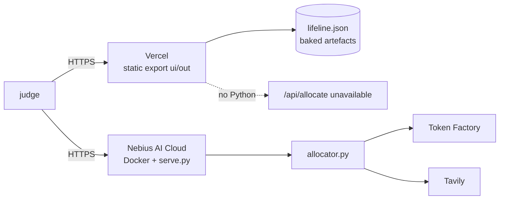

<div align="center">
  
</div>

# LIFELINE AI

### When the road dies, the town still has to decide.

**A disaster-response agent that allocates the last 100 litres of diesel, routes around a landslide, and
holds the decision at a human gate — reasoned by NVIDIA Nemotron 3 on Nebius Token Factory, with every
outside fact retrieved and checked through Tavily.**

<p>
  <a href="https://lifeline-ai-nebius.vercel.app"></a>
  
  
  
  
  
  
</p>

Solo entry · **Nebius × NVIDIA Global AI Hackathon 2026** · **Best Apps and Agents**
· **Best Use of Tavily** · [@abinivesh-m](https://github.com/abinivesh-m)

**Live demo:** <https://lifeline-ai-nebius.vercel.app> — verified 200 anonymously on 28 Oct 2026.
**Workflow replay:** <https://lifeline-ai-nebius.vercel.app/live/> — the eight-step event stream,
recorded from a real run and played back in the browser.

> **The town is real. The scenario is simulated.** Kottur, Pollachi Taluk, Coimbatore, Tamil Nadu —
> 11.0168 N, 76.9558 E — sits at the foot of the Western Ghats, where the **Pollachi–Valparai ghat road**
> closes under boulders every monsoon. The most recent real closure was **22 October 2026: reopened after
> 15 hours**
> ([New Indian Express](https://www.newindianexpress.com/states/tamil-nadu/2026/Oct/22/tamil-nadu-pollachi-valparai-ghat-road-reopens-after-15-hours-following-landslide)).
> The 6-hour closure, the 100 L reserve and the 70/30 split are **town data**, not a claim that a
> specific landslide happened on a specific date. [What is real](#what-is-real-and-what-is-simulated)
> draws that line precisely.

---

## At a glance

| | |
| --- | --- |
| **Live demo** | <https://lifeline-ai-nebius.vercel.app> — full interface, every artefact baked in |
| **Workflow** | <https://lifeline-ai-nebius.vercel.app/live/> — the recorded eight-step event stream, playable step by step |
| **What it is** | an agent that orders a town's survival dependencies, routes around a closure, and rations fuel |
| **Models** | Nemotron 3 Nano 30B-A3B · Super 120B · Ultra 550B, all on Nebius Token Factory |
| **Evidence** | Tavily search + extract + map + crawl, then a five-check verifier that rejects as often as it accepts |
| **Determinism** | 6 of 8 steps make no model call — four compute, two replay stored artefacts; the 70/30 result ships even when every API is down |
| **Measured spend** | **$0.027049** inference across 18 calls · **$1.056** Tavily across 132 credits · **$1.083049** combined |
| **Tests** | **78 passed**, standard library only, no network |
| **License** | MIT |

## Reading guide

| Time | Read | Why |
| --- | --- | --- |
| **60 seconds** | this page to [The eight steps](#the-eight-steps) | what it does and who decides |
| **5 minutes** | [Architecture](#architecture) → [Tavily](#tavily-evidence-you-can-re-check) → [What is real](#what-is-real-and-what-is-simulated) | the three claims that matter |
| **20 minutes** | [Run it](#run-it) and `python agent.py --yes --mode policy` | reproduce the eight steps with no key |

---

## The problem

The problem is ordering, not supply. A hospital generator with four hours left and a water pump on the
same feeder compete for 100 litres. Both draw from the one generator tank, so the pump's 30 L is a
budget line, not a second tank. Split 50/50 and the feeder browns out; give the hospital 70 and the
same pump runs three times longer on its 30. Same diesel, same town, three times the water.

The hard part is not the arithmetic. It is that the arithmetic depends on facts the town does not own:
whether the road is open, what a landslide does to a supply chain, how much fuel a hospital generator
actually burns. Those facts arrive from the web, and a wrong one is worse than no answer.

Lifeline separates the two. **The town's own numbers are data. Everything outside the town is evidence,
fetched and quoted.** The model proposes; code disposes.

## What it does

```text
100 L diesel  ->  hospital 70 L + water pump 30 L        exactly 100, no waste
route         ->  7.8 km village road vs the 13.0 km signposted bypass   (-40% trip fuel)
pump uptime   ->  30 min -> 90 min           water back in 2 h instead of 6 h
decision      ->  held at a human gate, never auto-executed
```

Eight steps. Six make no model call — four compute, two replay stored artefacts. One is a model proposal checked in code; the last is classified by a model, then held for a human.

## Screens

| Dependency order | Route | Allocation |
| --- | --- | --- |
|  |  |  |
| Kahn order puts the heart before the lungs | 4.2 km blocked, 7.8 km found | the model's proposal, checked field by field |

| Offline proof | Eight steps, one approval |
| --- | --- |
|  |  |
| the same plan with no network | one human touchpoint, then the replan |

### The workflow, as a judge sees it

[](https://lifeline-ai-nebius.vercel.app/live/)

The replay at **[/live/](https://lifeline-ai-nebius.vercel.app/live/)** plays the recorded event
stream: press play, or click any step in the rail. The frame above is step 05, the allocation, with the
validator verdict and the four evidence rows the model cited.


## Architecture



`brain.py` is the only file that knows a provider exists. The engine exports no model name, so the
deterministic path is identical whether the cloud answers or not.

## One decision, end to end



## The eight steps

| # | Step | Who does it | Needs a model? |
| --- | --- | --- | --- |
| 1 | Perceive flood extent | stored segmentation masks, replayed from `artifacts/` | no — stored artefact |
| 2 | Listen to field reports | stored transcript, replayed verbatim | no — stored artefact |
| 3 | Graph the town, sort dependencies | `dependency_graph.py` (Kahn) | **no** |
| 4 | Route around the landslide | `a_star.py` (heapq + haversine) | **no** |
| 5 | Allocate 100 L with evidence vs inference | `allocator.py` → Nemotron 3 Ultra | proposes; code validates |
| 6 | Budget the spend | `credit_tracker.py` + artefact reconciliation | **no** |
| 7 | Approve, escalate, speak | `escalation.py` + `seri_gate.py` | one human word |
| 8 | Replan when the world changes | `agent.py` | **no** |

Play the same eight steps back at <https://lifeline-ai-nebius.vercel.app/live/> — one event per step,
held at the human gate, then the replan after the depot is damaged.

## Why this is an agent, not a wrapper

Three separations, each enforced by tests:

1. **The model proposes, code disposes.** Ultra returns `{"allocation": ..., "justification": ...}`.
   Every field goes through the same validator the deterministic solver uses. Over-allocation, a short
   total, or starving the heart while funding the lungs is rejected with a reason, and the policy solver
   takes over. The 70/30 result ships either way.
2. **Evidence and inference are different objects.** Each `evidence[]` item carries the exact
   `town.json` path it came from; each `inference[]` item cites evidence ids (`because: ["E1","E2"]`).
   A test resolves every path and every cited id, so an invented justification fails CI.
3. **Web facts are quoted, not summarised.** See [Tavily](#tavily-evidence-you-can-re-check).

## Nemotron 3 on Token Factory

Three tiers, resolved from the live `GET /v1/models` catalogue rather than typed from memory, with prices
read from the same response:

| Tier | Model ID | $/M in → out | Used for |
| --- | --- | --- | --- |
| fast | `nvidia/NVIDIA-Nemotron-3-Nano-30B-A3B` | 0.06 → 0.24 | one measured triage call; too slow for long drafts |
| deep | `nvidia/nemotron-3-super-120b-a12b` | 0.30 → 0.90 | 8-language drafting **and** review of every locale |
| decision | `nvidia/Nemotron-3-Ultra-550b-a55b` | 1.00 → 3.00 | the one allocation that matters |

**The tier choice is measured, not assumed.** The same 8-language draft prompt, three ways:

| Model | Token cap | Result | Completion tokens | Wall |
| --- | --- | --- | --- | --- |
| Nano 30B-A3B | 6,000 | `finish_reason=length`, **empty content** | 6,000 (all reasoning) | 59 s |
| Nano 30B-A3B | 16,000 | answered | 3,449 | 38 s |
| Super 120b | 6,000 | answered | 966 | **6.7 s** |

Super is 5.6× faster and uses a third of the tokens for this task, so drafting runs on Super.
`reasoning_effort=low` does not bound Nano's thinking — that is a finding, not a workaround.

**Measured, not estimated:** the proof run measured Ultra at **3.37 s** for the allocation call
(the very first probe answered in 1.98 s), valid JSON, `{"hospital": 70, "water_pump": 30}`, validator
**PASS**. The proof artefact holds all three tiers: **4,834 tokens, $0.00595068, 15.33 s wall**. Reproduce
with `python scripts/nebius_proof.py`.

```python
import brain
brain.chat(prompt, tier="fast")      # Nano 30B-A3B
brain.chat(prompt, tier="deep")      # Super 120B, draft + review
brain.chat(prompt, tier="decision")  # Ultra 550B, the allocation
```

The tiering is the point of the entry: Nano and Super absorb the volume so that Ultra is affordable for
the single decision where reasoning changes the outcome.

## Tavily: evidence you can re-check

The engine's own numbers come from `town.json`. Everything **outside** the town — what a landslide does
to a highway, what a hospital generator actually needs, how often this repeats — comes from the web, and
a judge must be able to check it without trusting us.

Four endpoint types do real work, all at `advanced` depth:

| Call | What it buys | List price |
| --- | --- | --- |
| `POST /search` | ranked results **+ synthesised answer + full raw content + image descriptions**, domain-filtered, date-bounded | 2 credits |
| `POST /extract` | the pages actually opened, 20 per batch, markdown, with per-URL failures reported | 2 per 5 URLs |
| `POST /map` | the site structure of the authority being cited | 1 per 10 pages |
| `POST /crawl` | map + extract in one hop, to prove a source was explored, not stumbled on | map + extract |

### What the run actually produced

| Measure | Result |
| --- | --- |
| Queries in the merged proof | **10** |
| Leads returned | **65** |
| URLs fetched | **37** (3 failed and are listed as failures) |
| Images described | **45** |
| Synthesised answers | **10** |
| Site maps | **2** |
| Crawls | **3** |
| Claims checked | **17** |
| Claims accepted | **9** |
| Credits consumed across the build | **132** (47 calls) |
| Credit split | **60** search · **50** extract · **15** map · **7** crawl — 30 searches at advanced depth bill 2 each |

Every accepted and rejected row is in
[`artifacts/tavily_proof.json`](artifacts/tavily_proof.json), with its quote, URL, score, publication date
and verdict. Nothing is summarised into existence.

### The rule that makes it evidence

A claim is accepted only when **five** independent checks pass:



1. **Literal quote.** The quoted sentence is *sliced out of the fetched body*, so `quote in text` is
   true by construction. Nothing is paraphrased into existence.
2. **Fetched, not found.** The URL must appear in an `extract` success list. A search hit is a lead.
3. **Dated when it is an event.** Scenario mode requires a publication date inside the 2023 world the
   town replays; live mode requires the last 45 days. A mechanism claim ("generators run on diesel") may
   be timeless, and is labelled as such. No date on an event claim means `undated`, which is a rejection.
4. **Relevant.** Tavily's own relevance score must clear **0.20**.
5. **Regional.** The source must match the configured region terms (`LIFELINE_REGION_TERMS`), so a
   landslide story from another continent cannot support a Kottur claim.

Check 4 exists because the first run failed without it. A BBC story about an **M25 footbridge** was
accepted as support for "landslide closes road", purely because both sentences contained the word
*closed*. The score was **0.014**. That response is kept in the artefact under
`modes.scenario.rejected_examples`, outside the 17-claim totals, with its URL, quote, score and the
cached response it came from: it shows the false positive the verifier now catches.

### Two modes, never blended

| Mode | Question | Window |
| --- | --- | --- |
| **Scenario** | what did comparable 2023 events do to roads, grids and fuel? | 2023-11-01 → 2024-02-29 |
| **Live** | what is true on this road **today**? | last 45 days |

Blending them is how a 2023 figure gets quoted as current. The UI labels the mode on every row and the
artefact stores the window with the claim.

### Replay is free

Every response is cached by request hash, so the proof artefact rebuilds offline and re-running costs
zero credits:

```bash
python evidence.py --mode live                # real calls
python evidence.py --mode live --replay       # cache only, no network
```

Credits are read from the API's own `usage` field and appended to `artifacts/tavily_usage.json` — never
computed from a price table we wrote ourselves.

## Eight languages, one gate

The same alert is drafted in **English, Spanish, French, Chinese, Arabic, Portuguese, Swahili and Tamil**
by Nemotron 3 Super, then reviewed by Super, then checked in code for length, forbidden numbers, medical
advice, links and reply codes. The validator is the last word: a reviewer model cannot approve a payload
that contains an invented figure.

| Measure | Result |
| --- | --- |
| Locales with all three payloads valid | **8 / 8** |
| Model-drafted (not template fallback) | **8 / 8** |
| Drafting + review | **8 Super calls, $0.020234** |
| Spoken locales | **7** — Mandarin has no released MMS-TTS checkpoint, so it ships text-only |
| Clips rendered locally | **14** (alert + allocation, 7 locales) |
| Audio | **161.34 s**, MMS-TTS on CPU, **$0.00** |
| Voice gate | **7 / 7 approved, 0 withheld**, 7 Super calls, **$0.000864** |

The gate is not a button. A stored transcript is replayed, classified by Nemotron 3 Super, and decided in
code:



A misheard "no" must never dispatch fuel, so a question, a cough or a maybe is a no. The seven approvals
are sealed in a hash-chained ledger (`artifacts/escalation_ledger.json`).

TTS is explicitly **not** an NVIDIA model and **not** a Nebius endpoint. It runs locally on CPU, costs
nothing, and is labelled synthetic on screen.

## What it costs

Every figure below is measured in this repo. The unit prices are the catalogue rates; the token counts
and credit counts are the ones the APIs returned.

| What | Calls | Cost | Share of total |
| --- | --- | --- | --- |
| Nemotron 3 Ultra — the allocation | 1 | **$0.004968** | 0.46% |
| Nemotron 3 Super — draft, review, gate | 16 | **$0.021929** | 2.02% |
| Nemotron 3 Nano — one triage call | 1 | **$0.000152** | 0.01% |
| **Nebius inference total** | **18** | **$0.027049** | **2.50%** |
| Tavily — search, extract, map, crawl | 47 | **$1.056000** | 97.50% |
| **Combined cash-equivalent** | **65** | **$1.083049** | **100%** |

At build time the Nebius Token Factory balance was **$29.50**. Inference therefore used **0.0917%** of
that balance; the remaining **$29.472951** is untouched. Tavily's 132 credits are priced at its list rate
of **$0.008** and sit on Tavily's own account, not the Nebius one — the combined figure is the honest
cost of goods for the demo, not a claim that one provider bills the other.

<details>
<summary><b>Why the spend has this shape</b></summary>

**1. The deterministic core is $0.00 by construction.** Kahn ordering, A*, the 70/30 solver, the
validator, the ledger, the gate and the replan make no network call. There is no model where arithmetic
is sufficient, so the largest part of the product is free to run and impossible to rate-limit.

**2. Ultra is used once, on purpose.** The decision call cost **$0.004968** — half a cent — for 1,986
input tokens and 994 output tokens at $1.00 / $3.00 per million. The same call on a larger context or a
retry loop would still be cents. Tiering is what makes a 550B model rational for a single decision:
Super absorbs 16 calls for **$0.021929**, and Nano's one triage call cost **$0.000152**.

**3. Tavily is 97.5% of the bill because evidence is the expensive part.** A claim is not one search. It
is a search, then the pages actually opened, then a map or crawl to prove the source was explored, then a
literal-quote check. 47 calls consumed 132 credits; 17 claims were checked and **8 were rejected** —
rejections still cost credits, and that is the point. A cheaper verifier that accepts everything would
save $1.06 and destroy the product.

**4. The per-call unit economics are small enough to operate.** Ultra is **$0.004968 per decision**;
Super averages **$0.001371 per call**; Tavily averages **$0.022468 per call**. A town making one decision
per closure spends less than a cent on reasoning and about a dollar on proof.

**5. What is not in the table.** The figure is the cost of the artefacts that ship. A handful of
exploratory calls made while choosing tiers, and failed draft repairs, are visible in the provider
console but are not part of the shipping artefacts. They are not hidden; they are simply not claimed as
product cost.

</details>

The ledger alerts at **80% ($23.60)** and **95% ($28.03)** were never approached. The page shows the same
reconciled number the CLI prints: `python agent.py --yes --mode policy`.

## What is real, and what is simulated

| Item | Status |
| --- | --- |
| Kottur, its coordinates, the ghat road and its monsoon closures | **real** |
| Pollachi–Valparai closure, 22 Oct 2026, reopened after 15 h | **real**, linked above |
| `town.json` — 100 L reserve, 4 h generator, 70 L / 30 L demands, 6 h closure | **simulated**, chosen to be plausible |
| "December 2023 Kottur landslide" | **not claimed.** No such event is asserted anywhere in this repo |
| Flood masks, 9 frames, worst 59.4% | **stored pre-migration artefacts**, replayed and re-checked; no image model is called or billed in this build |
| ASR transcript, 10.78 s | **stored pre-migration transcript**, replayed verbatim; no ASR call is claimed or billed |
| Nemotron 3 calls | **real**, 18 calls, $0.027049, traces in `artifacts/` |
| Tavily sources, quotes, scores, credits | **real**, per-row in `artifacts/tavily_proof.json` |
| TTS clips | **MMS-TTS, local CPU** — explicitly *not* NVIDIA, labelled synthetic |
| SMS / WhatsApp / voice delivery | `PENDING_CREDENTIALS` — payloads built and logged, **none sent** |
| Demo deployment | **static demo live** at `https://lifeline-ai-nebius.vercel.app` — verified 200 anonymously, 28 Oct 2026. The live `/api/allocate` route runs only in the Nebius container, not on Vercel |

The stored-mask and stored-transcript rows are the ones a judge would otherwise catch. They are stated
before they are asked.

## Run it

Core is **standard library only** — no NumPy, no SDK, Python 3.11+ (measured on 3.14).

```bash
git clone https://github.com/abinivesh-m/lifeline-ai-nebius
cd lifeline-ai-nebius

python -m pytest -q                      # 78 tests, no network
python agent.py --yes --mode policy      # the eight steps, offline-safe
```

The agent runs with **no key at all** in policy mode. Keys add live calls:

```bash
cp .env.example .env                     # NEBIUS_API_KEY, TAVILY_API_KEY
python evidence.py --mode live           # Tavily: search + extract + map + crawl
python scripts/nebius_proof.py           # three real Nemotron calls, priced and timed
python allocator.py --mode auto          # live proposal, then the validator
python multilingual.py                   # 8 locales, drafted and reviewed on Super
python seri_gate.py --verify             # re-check the stored approvals
```

`.env` is git-ignored. No key appears in this repository, its history, or its artefacts.

### The UI

The UI is a static export, so it can be served by any file server:

```bash
cd ui
npm install
npm run build                            # static export to ui/out
cd ..
python deploy/serve.py                   # http://127.0.0.1:8080
```

`deploy/serve.py` is a stdlib server: it hosts the exported site and exposes `GET /api/health` plus
`POST /api/allocate`, which runs the real engine. No Node server is needed at demo time.

The judge-facing demo is the static site at <https://lifeline-ai-nebius.vercel.app>, with the workflow
replay at <https://lifeline-ai-nebius.vercel.app/live/>. Nothing to install and no local port to open.
`live.py` is the optional local runner behind that replay: it streams the same events over SSE, and the
replay is its recording, shipped as JSON so a static host can play it.

## Configuration

Every variable is optional: with none of them set, the deterministic core still runs and the solver
still returns 70/30. The template is [`.env.example`](.env.example).

| Variable | Default when unset | What it changes |
| --- | --- | --- |
| `NEBIUS_API_KEY` | empty → inference stays offline | bearer token for Token Factory |
| `NEBIUS_BASE_URL` | `https://api.tokenfactory.nebius.com/v1/` | OpenAI-compatible endpoint |
| `NEBIUS_MODEL_FAST` | `nvidia/NVIDIA-Nemotron-3-Nano-30B-A3B` | tier → model, for triage |
| `NEBIUS_MODEL_DEEP` | `nvidia/nemotron-3-super-120b-a12b` | tier → model, for drafting, review and the gate |
| `NEBIUS_MODEL_DECISION` | `nvidia/Nemotron-3-Ultra-550b-a55b` | tier → model, for the allocation |
| `NEBIUS_REASONING_EFFORT` | `low` | forwarded to the chat request |
| `NEBIUS_MAX_TOKENS` | `6000` | completion cap; the Nano measurement above is why it matters |
| `TAVILY_API_KEY` | empty → cached replay only | search, extract, map and crawl |
| `TAVILY_BASE_URL` | `https://api.tavily.com` | proxy or mirror |
| `LIFELINE_OFFLINE` | `0` | `1` makes every step local; no socket is opened |
| `LIFELINE_LEDGER` | `credit_usage.json` | append-only local spend ledger |
| `LIFELINE_REGION_TERMS` | the Kottur set | comma-separated terms for the regional check |
| `LIFELINE_TTS_REPO_PREFIX` | resolved at load time | mirror or offline prefix for the MMS-TTS checkpoint |
| `PORT` | `8080` | container port, read by `deploy/serve.py` |

Model IDs are defaults, not gospel: `brain.py` asks the catalogue for the real ids and prices, and the
env vars exist so a changed catalogue is a config edit, not a patch.

## Deploy it



**Static demo — live now: <https://lifeline-ai-nebius.vercel.app>**

Verified anonymously on 28 Oct 2026: the page, `/data/lifeline.json` and `/videos/flood.mp4` all return
**200** with no login. It is the exported `ui/out` folder served as a plain static site, so the page,
media, artefacts and the three.js scenes all work; `POST /api/allocate` does not, because Vercel is not
running the Python engine.

To reproduce the static deploy: Vercel project root `ui`, build command `npm run build`, output
directory `out`. The workflow replay at `/live/` is part of the same export: `ui/public/data/live_run.json`
holds the recorded event stream, so it needs no backend.

**Nebius AI Cloud (full demo).** The included `Dockerfile` builds the UI in a Node stage and serves it
from a Python stage with `deploy/serve.py`. Push the image to a registry, create a Serverless Endpoint,
set `NEBIUS_API_KEY` as a secret, and point the health check at `/api/health`. The container listens on
`$PORT` (default 8080). Full steps: [`deploy/README.md`](deploy/README.md).

The rule I hold myself to: a URL is listed here only after it returns 200 in a private window. That is
why the Vercel URL is above and the Nebius URL is not.

## The UI, section by section

The page is one continuous argument, in eight sections. Each one is a claim with its own evidence, not a
screenshot.

| # | Section | What it shows |
| --- | --- | --- |
| 01 | Dependency | the town as a DAG; Kahn order puts the heart before the lungs |
| 02 | Route | 4.2 km blocked, 7.8 km found, measured against the 13.0 km bypass |
| 03 | Blood intelligence | usable diesel at 42 °C, lot provenance, runtime hours — before a model speaks |
| 04 | Allocate | what Ultra returned, the validator verdict, evidence vs inference, the ledger |
| 05 | Late approval | four escalation tiers, 72 payloads, hash-chained, ending in a human decision |
| 06 | Offline + Nemotron | the same plan with the wire cut, and the three-tier call trace |
| 07 | Agentic run | the eight steps, each with the tool it actually called |
| 08 | World | 26 configured coordinates, one surveyed town, every template labelled as a template |

## Deterministic core, and how it is proved

| Claim | How it is proved |
| --- | --- |
| 7.8 km is the shortest open route | A* over 9 surveyed edges + brute-force enumeration of every simple path |
| The heuristic is admissible | `python a_star.py --audit` checks every edge ≥ its straight-line distance |
| 40% less trip fuel | 4.55 L → 2.73 L on the same vehicle model |
| 70/30 is optimal under the constraint | constrained solver + validator; 50/50 browns out the feeder |
| The blocked trail is abandoned | seeded ant colony (12 × 12, seed 7), <1% after 8 iterations |
| 78 acceptance tests | `python -m pytest -q` |

The honest framing of the route: 4.2 km is impassable, so the agent does not "save 5.2 km against the
direct road". It saves 40% against **the detour a human would actually drive**, and the CLI prints
exactly that.

## Repository layout

```text
brain.py                the only file that knows Nebius Token Factory exists
evidence.py             Tavily search/extract/map/crawl + the five-check verifier
allocator.py            70/30 solver, evidence vs inference, validator, model proposal
dependency_graph.py     Kahn sort, cascade blast radius
a_star.py               heapq A*, haversine, admissibility audit
protocols.py            snake-boat relay + seeded ant colony
seri_gate.py            spoken approval -> token check -> hash-chained ledger
multilingual.py         8-locale payloads, code-checked then model-reviewed
voice_synth.py          local MMS-TTS rendering, $0.00
credit_tracker.py       append-only spend ledger + plan thresholds
agent.py                the eight steps
live.py                 optional local streamed runner, development only
deploy/serve.py         static site + /api/allocate, no framework
deploy/README.md        Nebius AI Cloud and Vercel steps
Dockerfile              Node build stage + Python runtime stage
test_phase1.py          acceptance tests pinning the claims above
artifacts/              proofs: Nemotron calls, Tavily rows, gate, masks, audio
```

## Tests

```bash
python -m pytest -q
# 78 passed
```

The suite covers the route audit, the 70/30 constraint, the validator's rejection paths, the evidence
provenance, the five-check verifier, the hash chain, the 8-locale rules, the budget reconciliation and
the offline path. It makes no network call and needs no key.

## Feedback

Written from the build, not from the marketing page — see [`FEEDBACK.md`](FEEDBACK.md). It covers the
approval/credit gap, the near-duplicate model IDs, the missing `usage.cost_usd`, the absent TTFT trace,
the Docker assumption in the deploy path, and the two Tavily fields that would have saved code.

---

**License.** MIT — see [`LICENSE`](LICENSE).

**Contact.** abinivesh.1203@gmail.com — Kottur, Tamil Nadu, India.
