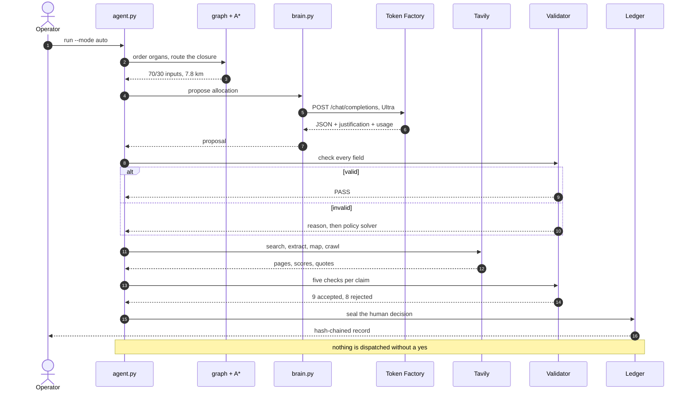
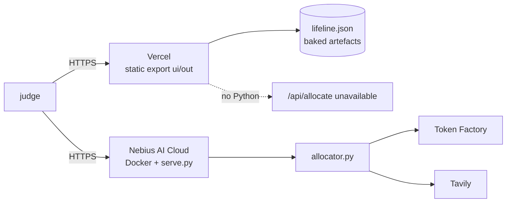

# Technical detail

The deep material behind the README: the end-to-end call, configuration, deployment, the UI map,
the deterministic proofs, and the file layout. The architecture diagram lives on the main page. Every figure here is the same figure the
README quotes, and every claim is one a test or an artefact can check.

---

## One decision, end to end



## Configuration

Every variable is optional: with none of them set, the deterministic core still runs and the solver
still returns 70/30. The template is [`.env.example`](../.env.example).

| Variable | Default when unset | What it changes |
| --- | --- | --- |
| `NEBIUS_API_KEY` | empty → inference stays offline | bearer token for Token Factory |
| `NEBIUS_BASE_URL` | `https://api.tokenfactory.nebius.com/v1/` | OpenAI-compatible endpoint |
| `NEBIUS_MODEL_FAST` | `nvidia/NVIDIA-Nemotron-3-Nano-30B-A3B` | tier → model, for triage |
| `NEBIUS_MODEL_DEEP` | `nvidia/nemotron-3-super-120b-a12b` | tier → model, for drafting, review and the gate |
| `NEBIUS_MODEL_DECISION` | `nvidia/Nemotron-3-Ultra-550b-a55b` | tier → model, for the allocation |
| `NEBIUS_REASONING_EFFORT` | `low` | forwarded to the chat request |
| `NEBIUS_MAX_TOKENS` | `6000` | completion cap; the Nano measurement is why it matters |
| `TAVILY_API_KEY` | empty → cached replay only | search, extract, map and crawl |
| `TAVILY_BASE_URL` | `https://api.tavily.com` | proxy or mirror |
| `LIFELINE_OFFLINE` | `0` | `1` makes every step local; no socket is opened |
| `LIFELINE_LEDGER` | `credit_usage.json` | append-only local spend ledger |
| `LIFELINE_REGION_TERMS` | the Kottur set | comma-separated terms for the regional check |
| `LIFELINE_TTS_REPO_PREFIX` | resolved at load time | mirror or offline prefix for the MMS-TTS checkpoint |
| `PORT` | `8080` | container port, read by `deploy/serve.py` |

Model IDs are defaults, not gospel: `brain.py` asks the catalogue for the real ids and prices, and the
env vars exist so a changed catalogue is a config edit, not a patch.

## Deploy it



**Static demo — live now: <https://lifeline-ai-nebius.vercel.app>**

Verified anonymously on 28 Oct 2026: the page, `/data/lifeline.json` and `/videos/flood.mp4` all return
**200** with no login. It is the exported `ui/out` folder served as a plain static site, so the page,
media, artefacts and the three.js scenes all work; `POST /api/allocate` does not, because Vercel is not
running the Python engine.

The Vercel project builds from the repository root: `vercel.json` installs and builds `ui/` and publishes
`ui/out`, so a push deploys the static export with no local step. The workflow replay at `/live/` is part
of the same export: `ui/public/data/live_run.json` holds the recorded event stream, so it needs no
backend.

**Nebius AI Cloud (full demo).** The included `Dockerfile` builds the UI in a Node stage and serves it
from a Python stage with `deploy/serve.py`. Push the image to a registry, create a Serverless Endpoint,
set `NEBIUS_API_KEY` as a secret, and point the health check at `/api/health`. The container listens on
`$PORT` (default 8080). Full steps: [`deploy/README.md`](../deploy/README.md).

The rule I hold myself to: a URL is listed here only after it returns 200 in a private window. That is
why the Vercel URL is above and the Nebius URL is not.

## The UI, section by section

The page is one continuous argument, in eight sections. Each one is a claim with its own evidence, not a
screenshot.

| # | Section | What it shows |
| --- | --- | --- |
| 01 | Dependency | the town as a DAG; Kahn order puts the heart before the lungs |
| 02 | Route | 4.2 km blocked, 7.8 km found, measured against the 13.0 km bypass |
| 03 | Blood intelligence | usable diesel at 42 °C, lot provenance, runtime hours — before a model speaks |
| 04 | Allocate | what Ultra returned, the validator verdict, evidence vs inference, the ledger |
| 05 | Late approval | four escalation tiers, 72 payloads, hash-chained, ending in a human decision |
| 06 | Offline + Nemotron | the same plan with the wire cut, and the three-tier call trace |
| 07 | Agentic run | the eight steps, each with the tool it actually called |
| 08 | World | 26 configured coordinates, one surveyed town, every template labelled as a template |

## Deterministic core, and how it is proved

| Claim | How it is proved |
| --- | --- |
| 7.8 km is the shortest open route | A* over 9 surveyed edges + brute-force enumeration of every simple path |
| The heuristic is admissible | `python a_star.py --audit` checks every edge ≥ its straight-line distance |
| 40% less trip fuel | 4.55 L → 2.73 L on the same vehicle model |
| 70/30 is optimal under the constraint | constrained solver + validator; 50/50 is rejected by the starvation rule |
| The blocked trail is abandoned | seeded ant colony (12 × 12, seed 7), <1% after 8 iterations |
| 78 acceptance tests | `python -m pytest -q` |

The honest framing of the route: 4.2 km is impassable, so the agent does not "save 5.2 km against the
direct road". It saves 40% against **the detour a human would actually drive**, and the CLI prints
exactly that.

## Repository layout

```text
brain.py                the only file that knows Nebius Token Factory exists
evidence.py             Tavily search/extract/map/crawl + the five-check verifier
allocator.py            70/30 solver, evidence vs inference, validator, model proposal
dependency_graph.py     Kahn sort, cascade blast radius
a_star.py               heapq A*, haversine, admissibility audit
protocols.py            snake-boat relay + seeded ant colony
seri_gate.py            spoken approval -> token check -> hash-chained ledger
multilingual.py         8-locale payloads, code-checked then model-reviewed
voice_synth.py          local MMS-TTS rendering, $0.00
credit_tracker.py       append-only spend ledger + plan thresholds
agent.py                the eight steps
live.py                 optional local streamed runner, development only
deploy/serve.py         static site + /api/allocate, no framework
deploy/README.md        Nebius AI Cloud and Vercel steps
Dockerfile              Node build stage + Python runtime stage
test_phase1.py          acceptance tests pinning the claims above
artifacts/              proofs: Nemotron calls, Tavily rows, gate, masks, audio
```
